<picture>
  <source media="(prefers-reduced-motion: reduce) and (max-width: 600px)" srcset="docs/readme/hero-mobile.svg">
  <source media="(prefers-reduced-motion: reduce)" srcset="docs/readme/hero.svg">
  <source media="(max-width: 600px)" srcset="docs/readme/motion/hero-mobile.svg">
  
</picture>

Площадка для покупки и продажи игровых предметов и цифровых услуг. Самостоятельный pet-проект для практики Java Backend: от каталога объявлений до сделок, балансов и чата в реальном времени. Интерфейс — на React и TypeScript.

Основной функционал реализован.

[Возможности](#features) · [Скриншоты](#screenshots) · [Запуск](#run) · [API](#api) · [Проверки](#tests)

<h2 id="features">
<picture>
  <source media="(prefers-reduced-motion: reduce) and (max-width: 600px)" srcset="docs/readme/headings/features-mobile.svg">
  <source media="(prefers-reduced-motion: reduce)" srcset="docs/readme/headings/features.svg">
  <source media="(max-width: 600px)" srcset="docs/readme/motion/headings/features-mobile.svg">
  
</picture>
</h2>

- **Каталог:** игры и сервисы, объявления с изображениями и пагинацией. У продавца — до пяти активных объявлений.
- **Сделки:** оформление заказа, внутренний баланс, подтверждение выполнения и возврат средств.
- **Репутация:** оценки и отзывы покупателей, ответы продавцов.
- **Профиль:** аватар, информация о себе, активные объявления и отзывы.
- **Чат заказа:** сообщения через WebSocket, история, восстановление после разрыва соединения и системные события. Переписка доступна и после завершения сделки.
- **Администрирование:** управление каталогом и объявлениями, поиск заказов, просмотр переписки и разбор споров.

<picture>
  <source media="(prefers-reduced-motion: reduce) and (max-width: 600px)" srcset="docs/readme/order-flow-mobile.svg">
  <source media="(prefers-reduced-motion: reduce)" srcset="docs/readme/order-flow.svg">
  <source media="(max-width: 600px)" srcset="docs/readme/motion/order-flow-mobile.svg">
  
</picture>

Подтверждение и возврат — два разных исхода открытого заказа. При споре администратор может повторно открыть закрытый заказ и принять решение по переписке. Возврат после закрытия может привести к отрицательному балансу продавца, если он уже потратил оплату.

<h2 id="screenshots">
<picture>
  <source media="(prefers-reduced-motion: reduce) and (max-width: 600px)" srcset="docs/readme/headings/screenshots-mobile.svg">
  <source media="(prefers-reduced-motion: reduce)" srcset="docs/readme/headings/screenshots.svg">
  <source media="(max-width: 600px)" srcset="docs/readme/motion/headings/screenshots-mobile.svg">
  
</picture>
</h2>

**Каталог игр и сервисов**

[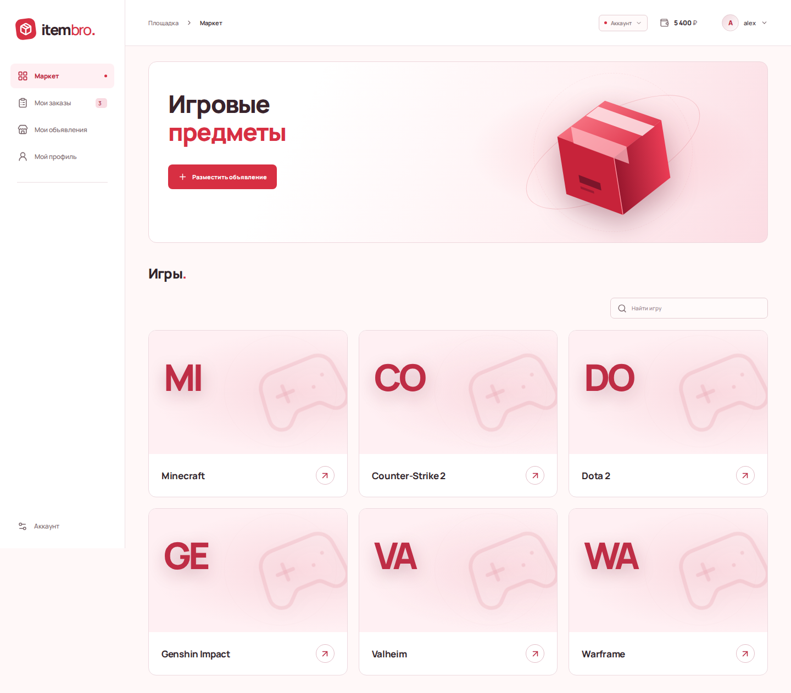](docs/screenshots/market.png)

**От заказа к завершённой сделке**

| Заказ и переписка | Отзыв и ответ продавца |
| --- | --- |
| [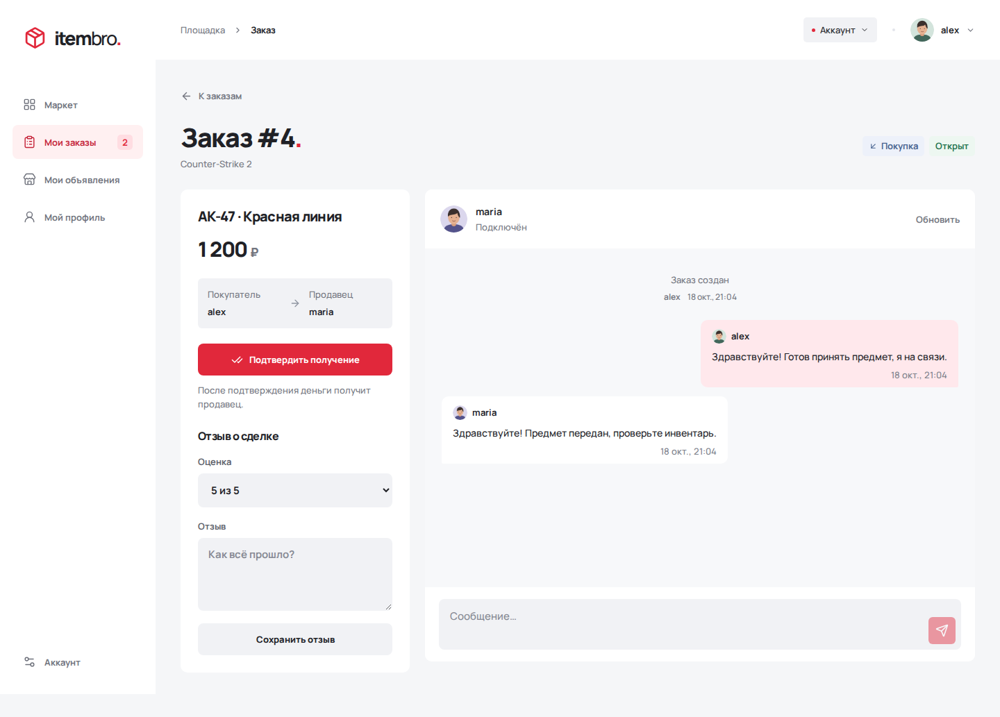](docs/screenshots/order.png) | [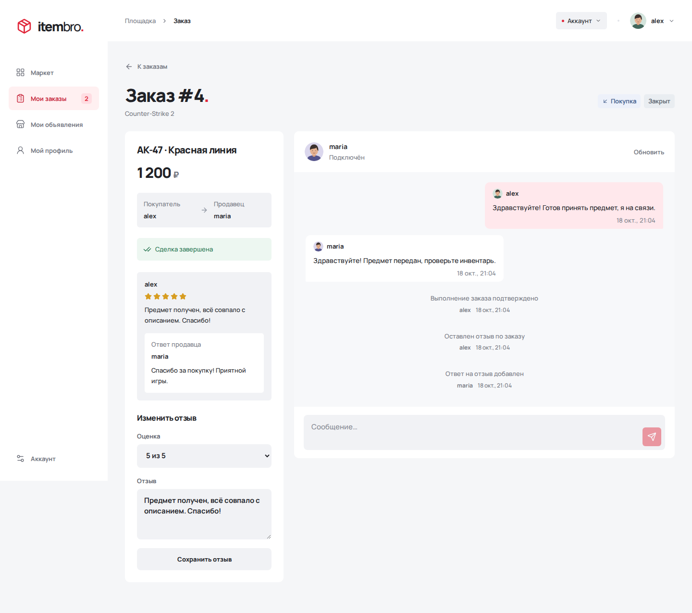](docs/screenshots/order-completed.png) |

<details>
<summary>Объявления, профиль и администрирование</summary>

| Объявления | Профиль продавца |
| --- | --- |
| [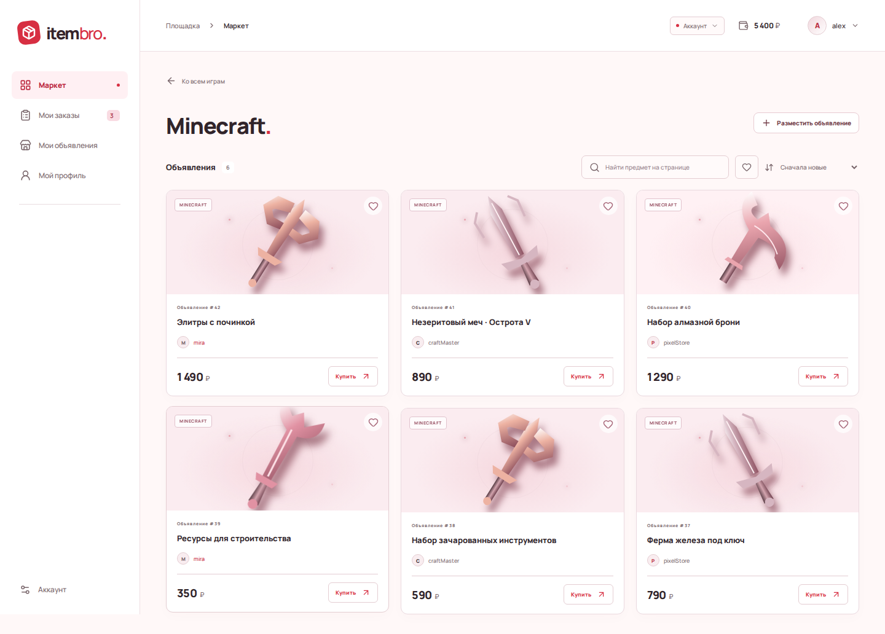](docs/screenshots/listings.png) | [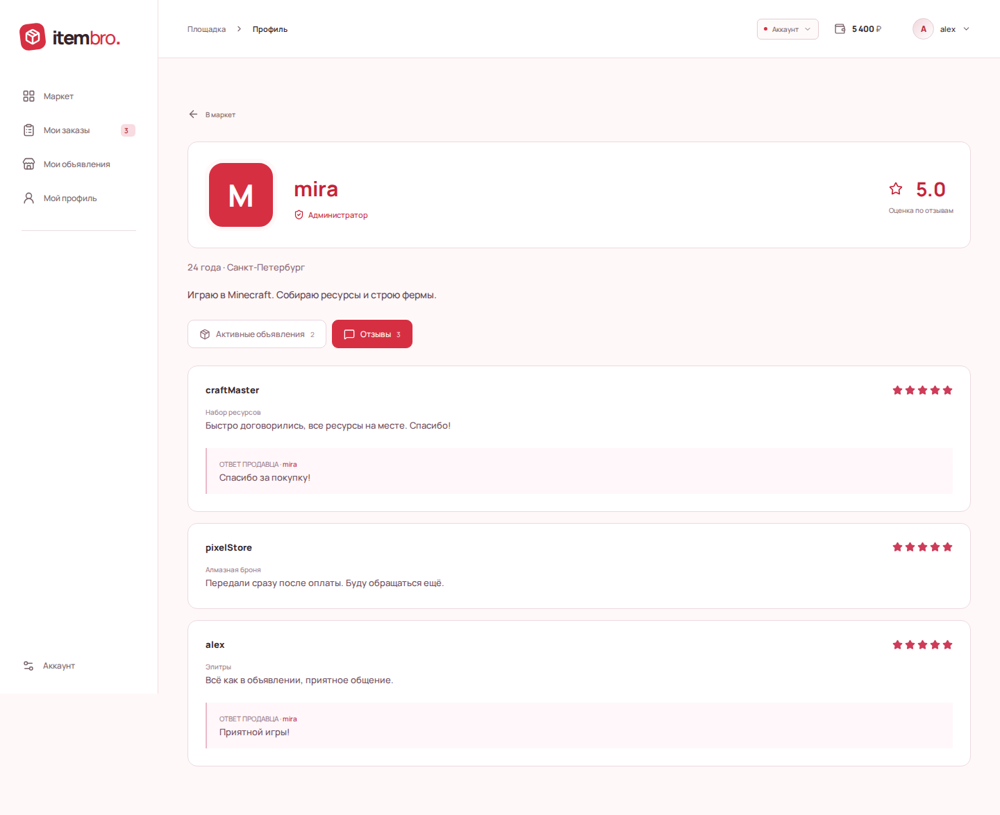](docs/screenshots/profile.png) |

[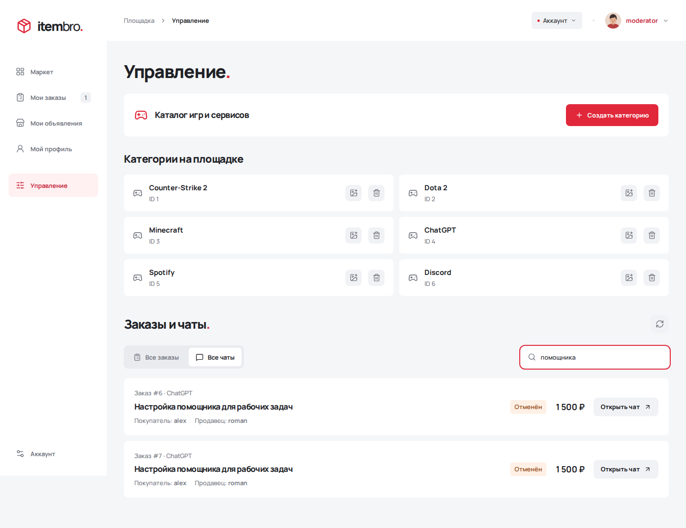](docs/screenshots/admin-chats.png)

</details>

<details>
<summary>Разбор споров: возврат покупателю и решение в пользу продавца</summary>

**Спор с продавцом.** Администратор открывает закрытый заказ и возвращает деньги покупателю.

| Заказ открыт для разбора | Возврат покупателю |
| --- | --- |
| [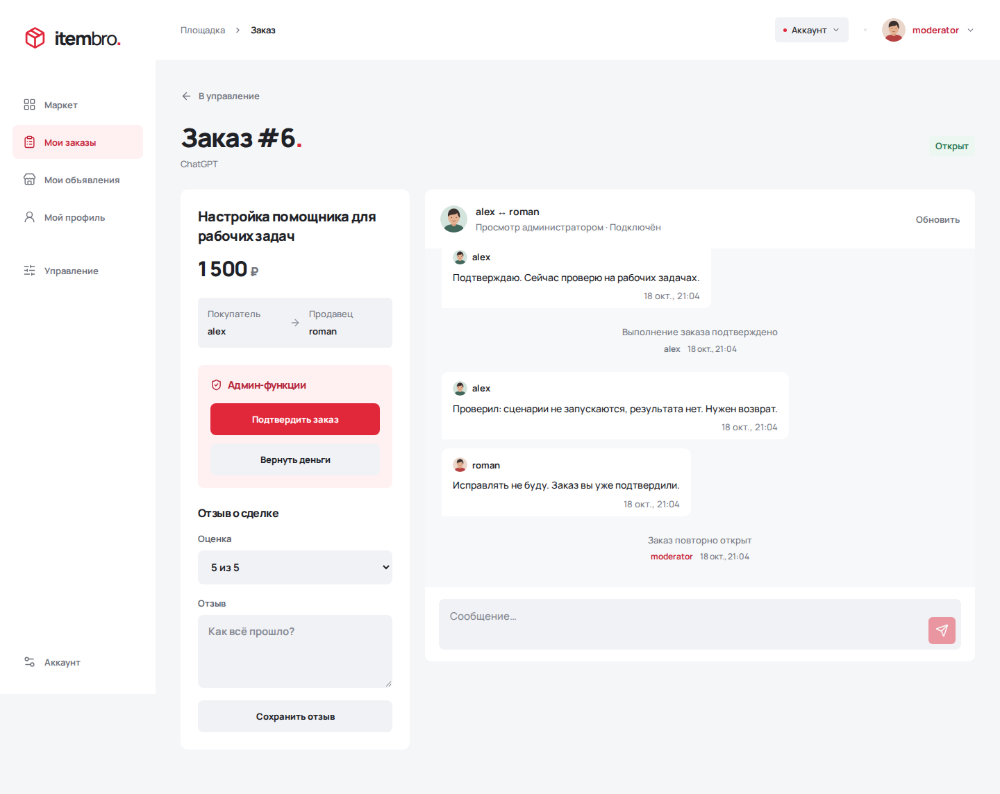](docs/screenshots/seller-dispute-reopened.png) | [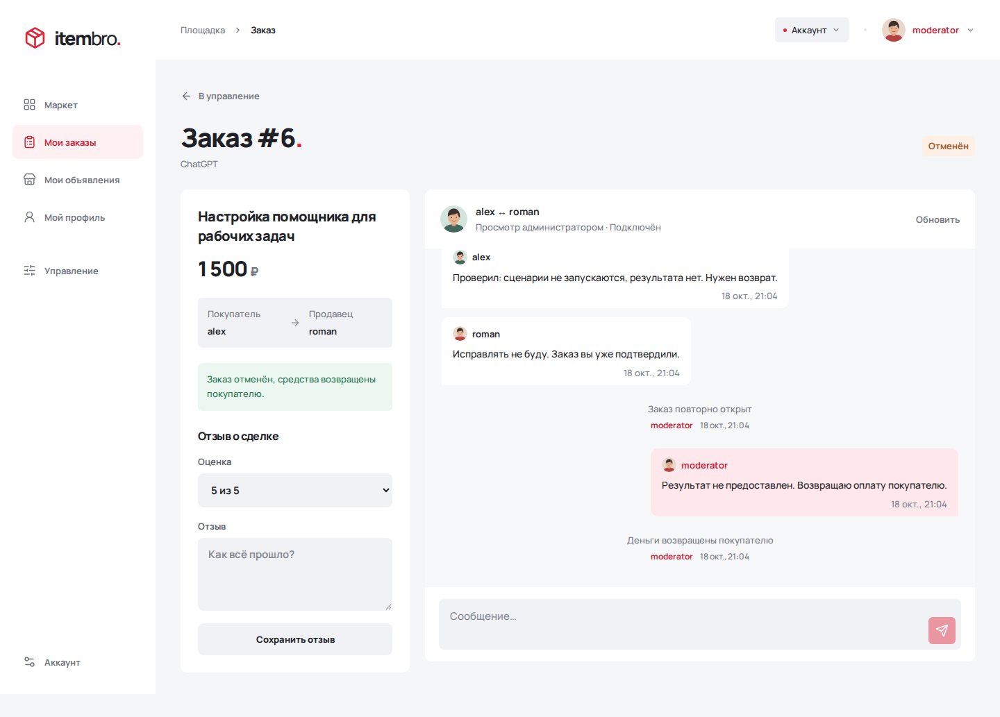](docs/screenshots/seller-dispute-refund.png) |

**Спор с покупателем.** Администратор проверяет переписку и повторно подтверждает выполнение в пользу продавца.

| Требование возврата | Решение в пользу продавца |
| --- | --- |
| [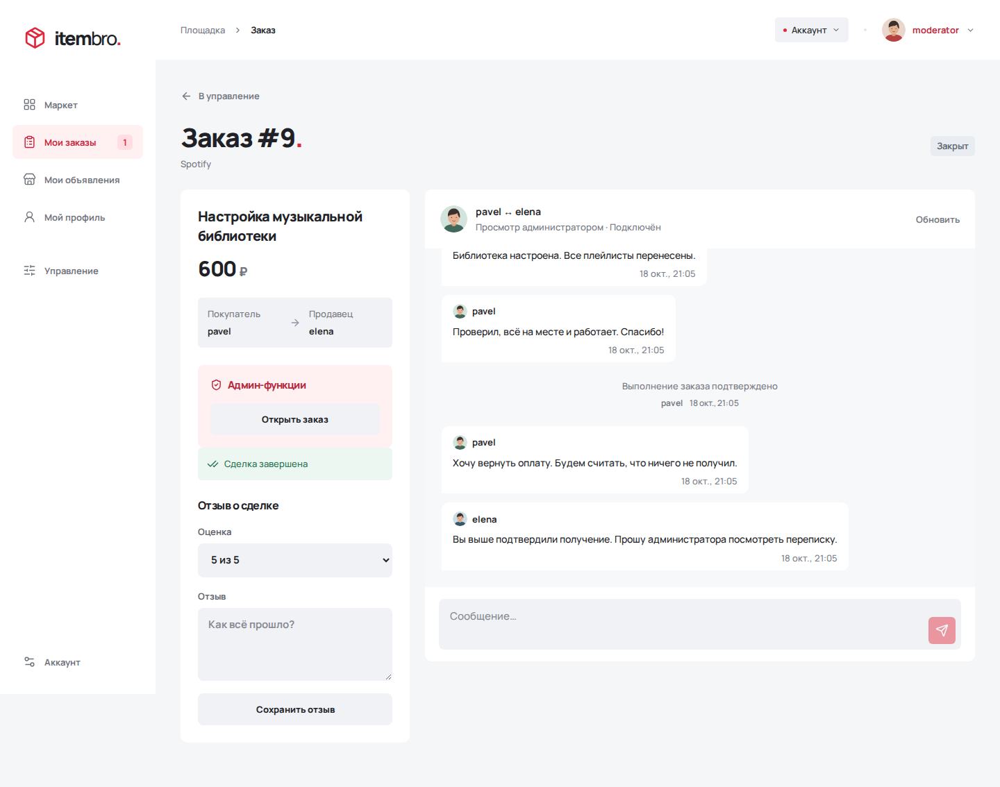](docs/screenshots/buyer-dispute-claim.png) | [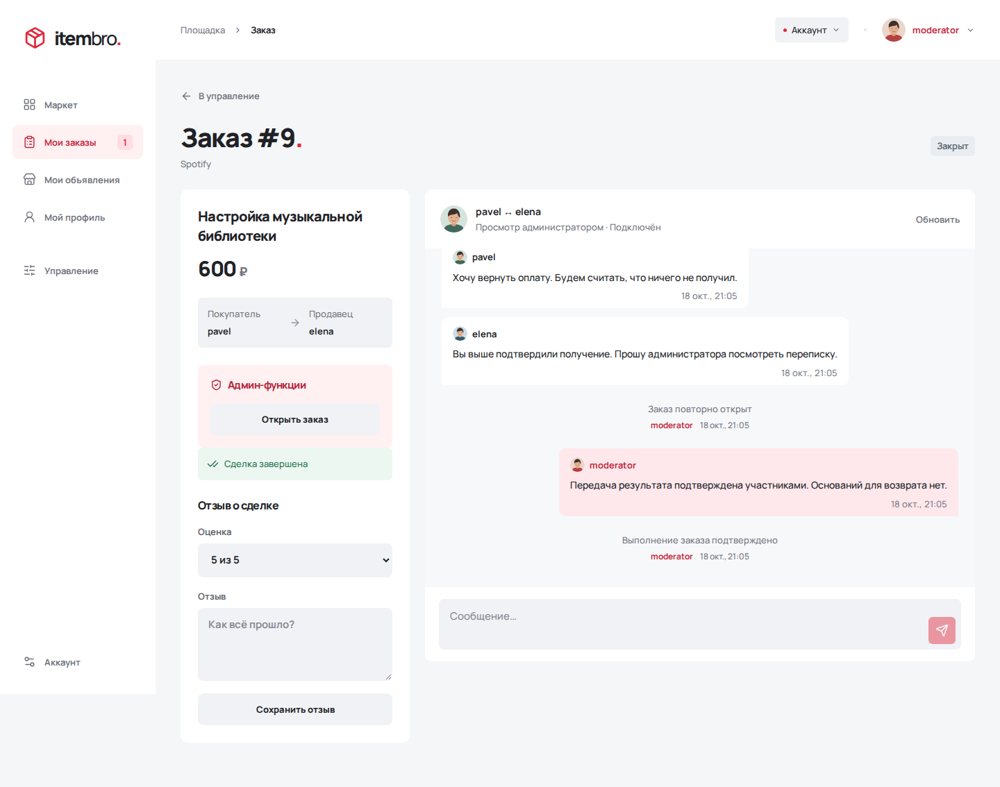](docs/screenshots/buyer-dispute-confirmed.png) |

</details>

<details>
<summary>Мобильная версия: каталог и чат заказа</summary>

| Каталог | Заказ и чат |
| --- | --- |
| [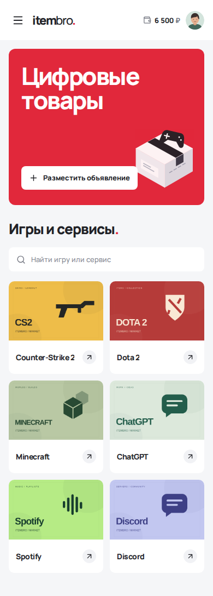](docs/screenshots/mobile-market.png) | [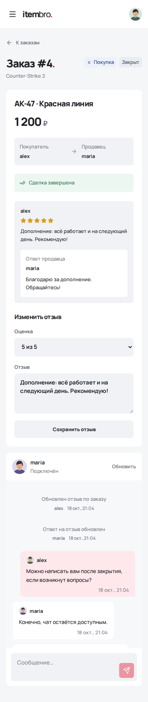](docs/screenshots/mobile-order.png) |

</details>

<h2 id="stack">
<picture>
  <source media="(prefers-reduced-motion: reduce) and (max-width: 600px)" srcset="docs/readme/headings/stack-mobile.svg">
  <source media="(prefers-reduced-motion: reduce)" srcset="docs/readme/headings/stack.svg">
  <source media="(max-width: 600px)" srcset="docs/readme/motion/headings/stack-mobile.svg">
  
</picture>
</h2>

**Backend**

<picture>
  <source media="(prefers-reduced-motion: reduce)" srcset="docs/readme/stack/java.svg">
  
</picture>
<picture>
  <source media="(prefers-reduced-motion: reduce)" srcset="docs/readme/stack/spring-boot.svg">
  
</picture>
<picture>
  <source media="(prefers-reduced-motion: reduce)" srcset="docs/readme/stack/spring-security.svg">
  
</picture>
<picture>
  <source media="(prefers-reduced-motion: reduce)" srcset="docs/readme/stack/spring-data-jpa.svg">
  
</picture>
<picture>
  <source media="(prefers-reduced-motion: reduce)" srcset="docs/readme/stack/hibernate.svg">
  
</picture>
<picture>
  <source media="(prefers-reduced-motion: reduce)" srcset="docs/readme/stack/postgresql.svg">
  
</picture>
<picture>
  <source media="(prefers-reduced-motion: reduce)" srcset="docs/readme/stack/flyway.svg">
  
</picture>
<picture>
  <source media="(prefers-reduced-motion: reduce)" srcset="docs/readme/stack/websocket.svg">
  
</picture>

**Frontend**

<picture>
  <source media="(prefers-reduced-motion: reduce)" srcset="docs/readme/stack/react.svg">
  
</picture>
<picture>
  <source media="(prefers-reduced-motion: reduce)" srcset="docs/readme/stack/typescript.svg">
  
</picture>
<picture>
  <source media="(prefers-reduced-motion: reduce)" srcset="docs/readme/stack/vite.svg">
  
</picture>
<picture>
  <source media="(prefers-reduced-motion: reduce)" srcset="docs/readme/stack/nginx.svg">
  
</picture>

**Окружение и тестирование**

<picture>
  <source media="(prefers-reduced-motion: reduce)" srcset="docs/readme/stack/docker-compose.svg">
  
</picture>
<picture>
  <source media="(prefers-reduced-motion: reduce)" srcset="docs/readme/stack/maven.svg">
  
</picture>
<picture>
  <source media="(prefers-reduced-motion: reduce)" srcset="docs/readme/stack/junit.svg">
  
</picture>
<picture>
  <source media="(prefers-reduced-motion: reduce)" srcset="docs/readme/stack/mockmvc.svg">
  
</picture>
<picture>
  <source media="(prefers-reduced-motion: reduce)" srcset="docs/readme/stack/testcontainers.svg">
  
</picture>
<picture>
  <source media="(prefers-reduced-motion: reduce)" srcset="docs/readme/stack/playwright.svg">
  
</picture>

<h2 id="architecture">
<picture>
  <source media="(prefers-reduced-motion: reduce) and (max-width: 600px)" srcset="docs/readme/headings/architecture-mobile.svg">
  <source media="(prefers-reduced-motion: reduce)" srcset="docs/readme/headings/architecture.svg">
  <source media="(max-width: 600px)" srcset="docs/readme/motion/headings/architecture-mobile.svg">
  
</picture>
</h2>

<picture>
  <source media="(prefers-reduced-motion: reduce) and (max-width: 600px)" srcset="docs/readme/architecture-mobile.svg">
  <source media="(prefers-reduced-motion: reduce)" srcset="docs/readme/architecture.svg">
  <source media="(max-width: 600px)" srcset="docs/readme/motion/architecture-mobile.svg">
  
</picture>

- **Доступ:** HTTP Basic для входа, затем серверная сессия и cookie `JSESSIONID`. Изменяющие запросы защищены CSRF; пароли хешируются BCrypt.
- **Бизнес-операции:** транзакции связывают изменения заказа, балансов и системных сообщений. В сущностях используется `@Version`, а подтверждение и возврат блокируют запись заказа через `PESSIMISTIC_WRITE`.
- **Чат:** доступ проверяется для участников заказа и администратора. События WebSocket публикуются после фиксации транзакции; история доступна через REST.
- **Данные:** Flyway управляет схемой, Hibernate проверяет её соответствие сущностям. Изображения хранятся отдельно от PostgreSQL.

Исходники разделены по предметным областям: [User](src/main/java/ItemBro/User), [Game](src/main/java/ItemBro/Game), [Advice](src/main/java/ItemBro/Advice), [Order и Chat](src/main/java/ItemBro/Order), [Media](src/main/java/ItemBro/Media), [Security](src/main/java/ItemBro/Security).

<h2 id="run">
<picture>
  <source media="(prefers-reduced-motion: reduce) and (max-width: 600px)" srcset="docs/readme/headings/run-mobile.svg">
  <source media="(prefers-reduced-motion: reduce)" srcset="docs/readme/headings/run.svg">
  <source media="(max-width: 600px)" srcset="docs/readme/motion/headings/run-mobile.svg">
  
</picture>
</h2>

Нужны **Docker и Docker Compose**. Из корня репозитория:

```bash
git clone https://github.com/Kriksson/item-bro.git
cd item-bro

docker compose up --build -d
docker compose -f frontend/compose.yaml up --build -d
```

| Компонент | Адрес |
| --- | --- |
| Интерфейс | [localhost:5173](http://localhost:5173) |
| Backend API | [localhost:8085](http://localhost:8085) |

Первый Compose запускает Spring Boot и PostgreSQL 17. Второй подключает Nginx к сети `item-bro_default` и проксирует API и WebSocket к backend. База данных и загруженные изображения сохраняются в volumes `postgres_data` и `uploads_data`.

Параметры базы задаются через `DB_NAME`, `DB_USER` и `DB_PASSWORD`; значения для локального запуска уже есть в [compose.yaml](compose.yaml). При изменении имени Docker-сети укажите `ITEMBRO_NETWORK` для frontend. `API_UPSTREAM` меняет адрес backend для Nginx.

Новый пользователь регистрируется с нулевым балансом. В репозитории нет платёжной интеграции и готовых демонстрационных аккаунтов; игровые данные на скриншотах не загружаются автоматически при старте.

<details>
<summary>Локальный демосценарий: каталог, объявление и покупка</summary>

1. Зарегистрируйте в интерфейсе три учебных аккаунта: `demo_admin`, `demo_seller` и `demo_buyer`. Пароли задайте самостоятельно.
2. Выдайте первому роль администратора, а покупателю — учебный баланс в локальной базе:

```bash
docker compose exec -T db sh -c 'psql -U "$POSTGRES_USER" -d "$POSTGRES_DB"' <<'SQL'
UPDATE users SET role = 'ADMIN' WHERE username = 'demo_admin';
UPDATE users SET balance = 1000.00 WHERE username = 'demo_buyer';
SQL
```

3. Выйдите из аккаунта и войдите как `demo_admin`, чтобы создать игру или сервис через управление каталогом.
4. Под `demo_seller` разместите объявление с ценой не выше учебного баланса. Под `demo_buyer` оформите заказ, напишите в чат и подтвердите выполнение.

Этот сценарий использует только локальные аккаунты и внутренний баланс приложения.

</details>

<details>
<summary>Логи и остановка</summary>

```bash
docker compose logs -f app
docker compose -f frontend/compose.yaml logs -f frontend

docker compose -f frontend/compose.yaml down
docker compose down
```

Остановка этими командами сохраняет данные в volumes.

</details>

<details>
<summary>Разработка frontend через Vite</summary>

При работающем backend нужны Node.js и npm:

```bash
cd frontend
npm ci
npm run dev
```

Vite использует порт `5173` и проксирует `/api`, `/csrf` и WebSocket на `http://127.0.0.1:8085`. Для другого backend настройте `BACKEND_URL` по [frontend/.env.example](frontend/.env.example). Перед запуском Vite освободите порт `5173`, если на нём уже работает Nginx.

</details>

<h2 id="api">
<picture>
  <source media="(prefers-reduced-motion: reduce) and (max-width: 600px)" srcset="docs/readme/headings/api-mobile.svg">
  <source media="(prefers-reduced-motion: reduce)" srcset="docs/readme/headings/api.svg">
  <source media="(max-width: 600px)" srcset="docs/readme/motion/headings/api-mobile.svg">
  
</picture>
</h2>

Основные точки входа:

| Область | Маршруты |
| --- | --- |
| Каталог | `GET /api/games`, `GET /api/advices` |
| Регистрация и сессия | `POST /api/user`, `GET /api/user/me`, `POST /api/logout`, `GET /csrf` |
| Публичный профиль | `GET /api/users/{username}`, `GET /api/users/{username}/reviews` |
| Объявления | `POST /api/advices`, `DELETE /api/advices/{id}` |
| Заказы | `POST /api/orders/`, `GET /api/orders`, `GET /api/orders/{id}` |
| Действия с заказом | `PATCH /api/orders/{id}/confirm`, `/cancel`, `/feedback`, `/response` |
| Чат | `GET` и `POST /api/orders/{id}/messages`, WebSocket `/api/orders/{id}/chat/ws` |
| Администрирование | `GET /api/admin/orders`, `PATCH /api/admin/orders/{id}/reopen`, `/confirm`, `/refund` |
| Изображения | `GET /api/media/{fileId}`; загрузка через маршруты аватара, игры и объявления |

Получить публичный каталог:

```bash
curl http://localhost:8085/api/games
```

Форматы запросов и DTO находятся рядом с контроллерами в `src/main/java/ItemBro`. Защищённые операции записи используют сессию и CSRF-токен из `/csrf`.

<h2 id="tests">
<picture>
  <source media="(prefers-reduced-motion: reduce) and (max-width: 600px)" srcset="docs/readme/headings/tests-mobile.svg">
  <source media="(prefers-reduced-motion: reduce)" srcset="docs/readme/headings/tests.svg">
  <source media="(max-width: 600px)" srcset="docs/readme/motion/headings/tests-mobile.svg">
  
</picture>
</h2>

**Backend:** Java 21 и работающий Docker. Тесты поднимают PostgreSQL через Testcontainers:

```bash
./mvnw test
```

Проверяются права доступа, заказы и балансы, отзывы, изображения и профили, сессии, WebSocket и системные события. Тесты находятся в [src/test/java/ItemBro](src/test/java/ItemBro).

**Frontend:** Playwright запускает свой Vite-сервер на порту `5183`. Ответы API в UI-тестах задаются через `page.route`.

```bash
cd frontend
npm ci
npx playwright install chromium
npm test
npm run build
```

В [GitHub Actions](.github/workflows) backend проверяется при push и pull request в `master`: Maven `verify`, PostgreSQL через Testcontainers и сохранение Surefire-отчётов. В сборке включён `-DfailIfNoTests=true`.

Связанный репозиторий автотестов: [QA ItemBro](https://github.com/Kriksson/QA_Item_Bro).

---

[Кирилл / Kriksson](https://github.com/Kriksson)
