# ItemBro

Площадка для покупки и продажи игровых предметов и цифровых услуг. Бэкенд на Java и Spring Boot, фронтенд на React и TypeScript.

**Статус: разработка завершена.**

## Возможности

- Общий каталог игр и сервисов
- Объявления с изображениями, до пяти активных у одного продавца.
- Покупки и продажи через внутренний баланс, подтверждение заказа и возврат средств.
- Оценки и отзывы покупателей, ответы продавцов.
- Профили с аватаркой, информацией о себе и активными объявлениями.
- Чат заказа через WebSocket с историей и системными сообщениями. Переписка доступна после завершения сделки.
- Управление каталогом и объявлениями, поиск заказов, доступ к чатам и разбор споров для администратора.

## Скриншоты

### Каталог, профиль и управление

| Каталог игр и сервисов | Объявления |
| --- | --- |
| [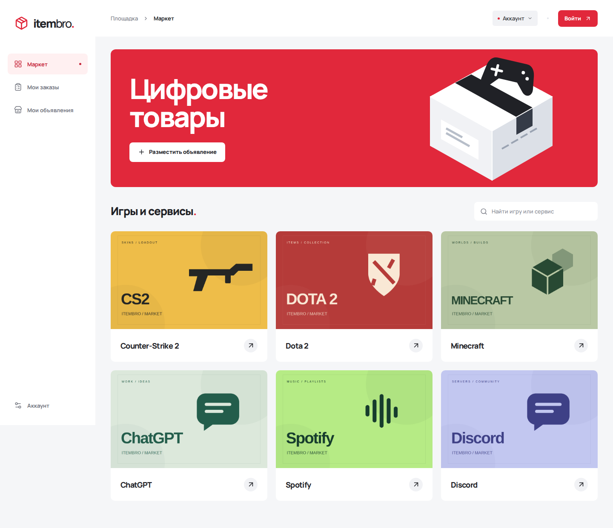](docs/screenshots/market.png) | [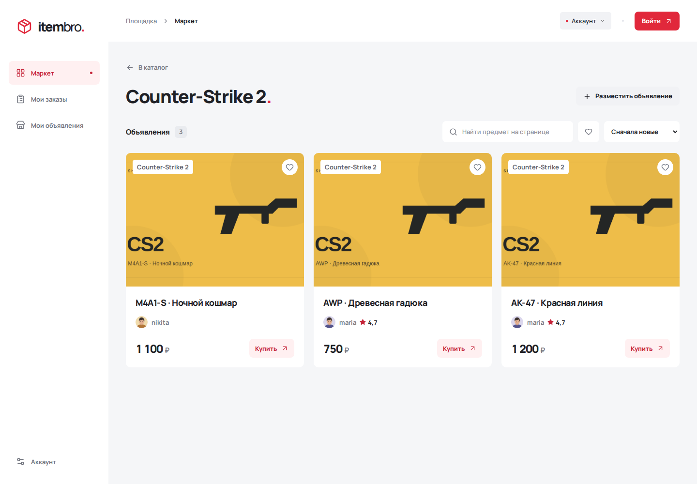](docs/screenshots/listings.png) |

| Профиль продавца | Управление и поиск заказов |
| --- | --- |
| [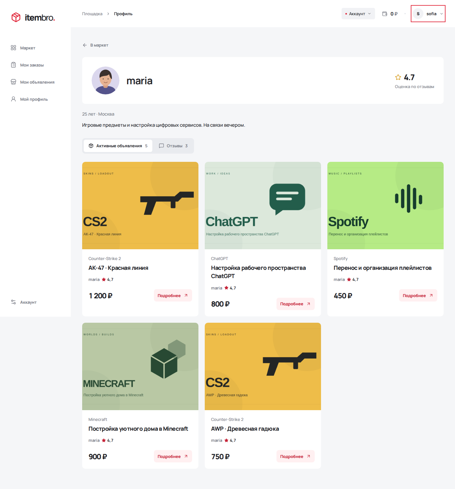](docs/screenshots/profile.png) | [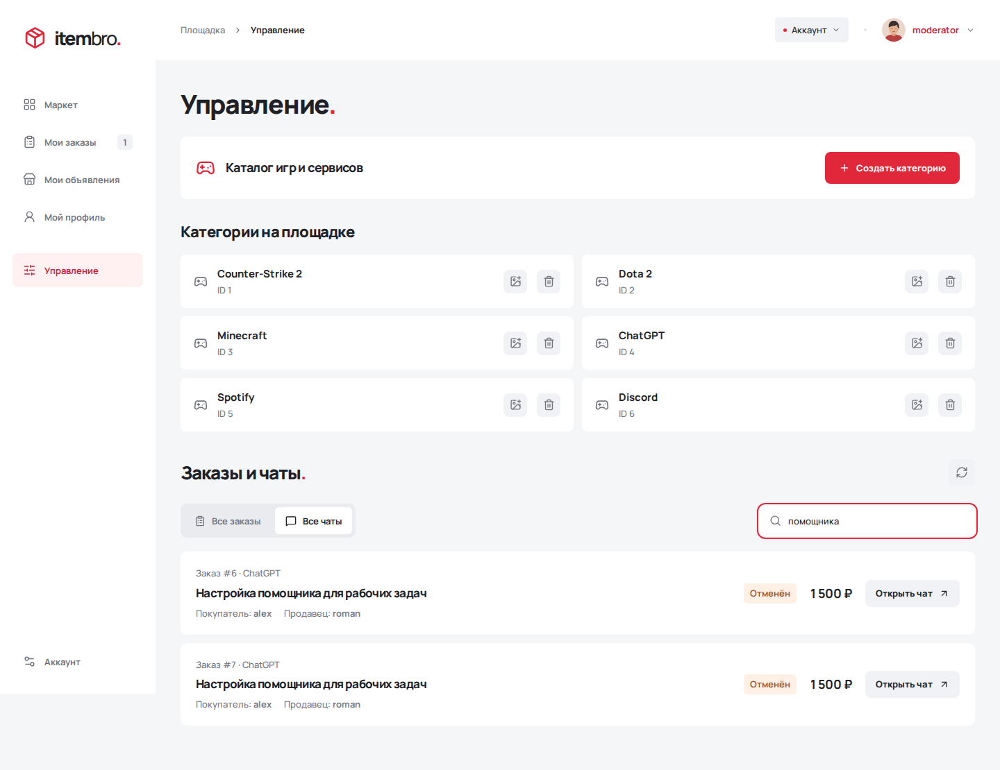](docs/screenshots/admin-chats.png) |

### Заказ и чат

| Заказ и переписка участников | Завершённая сделка, отзыв и ответ |
| --- | --- |
| [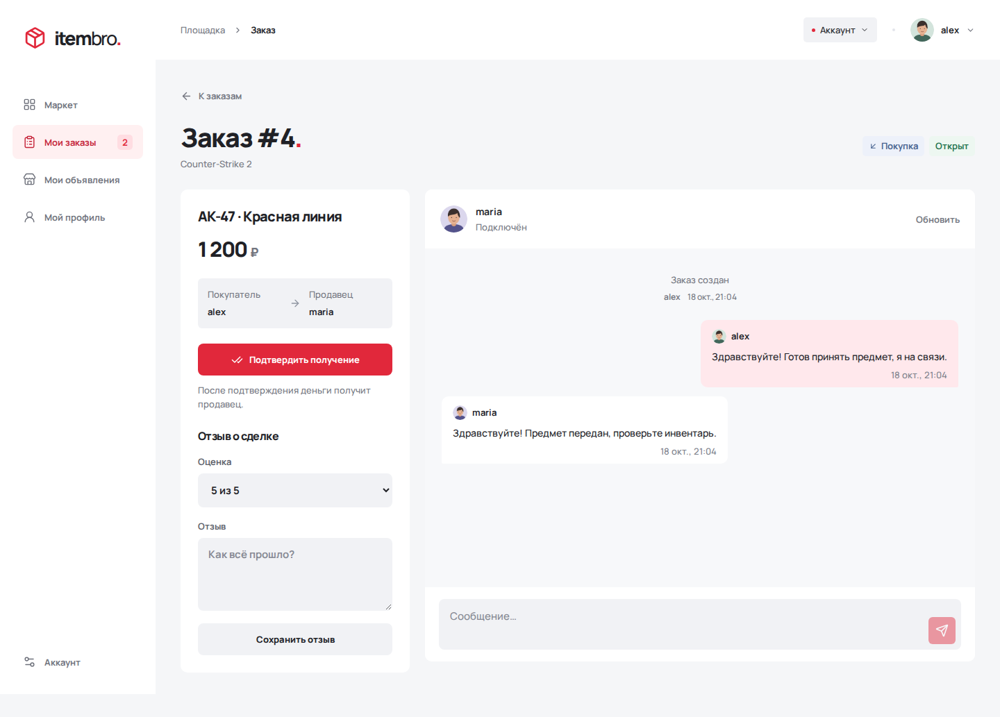](docs/screenshots/order.png) | [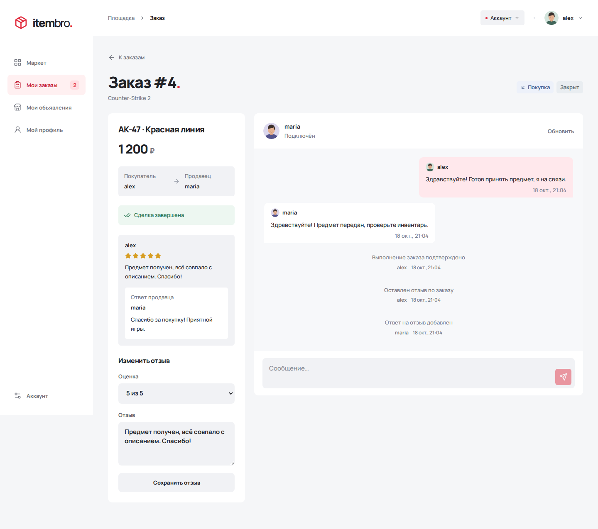](docs/screenshots/order-completed.png) |

### Спор с продавцом

После жалобы покупателя администратор открывает закрытый заказ и возвращает деньги. Если продавец уже потратил оплату, его баланс может стать отрицательным.

| Заказ открыт для разбора | Возврат покупателю |
| --- | --- |
| [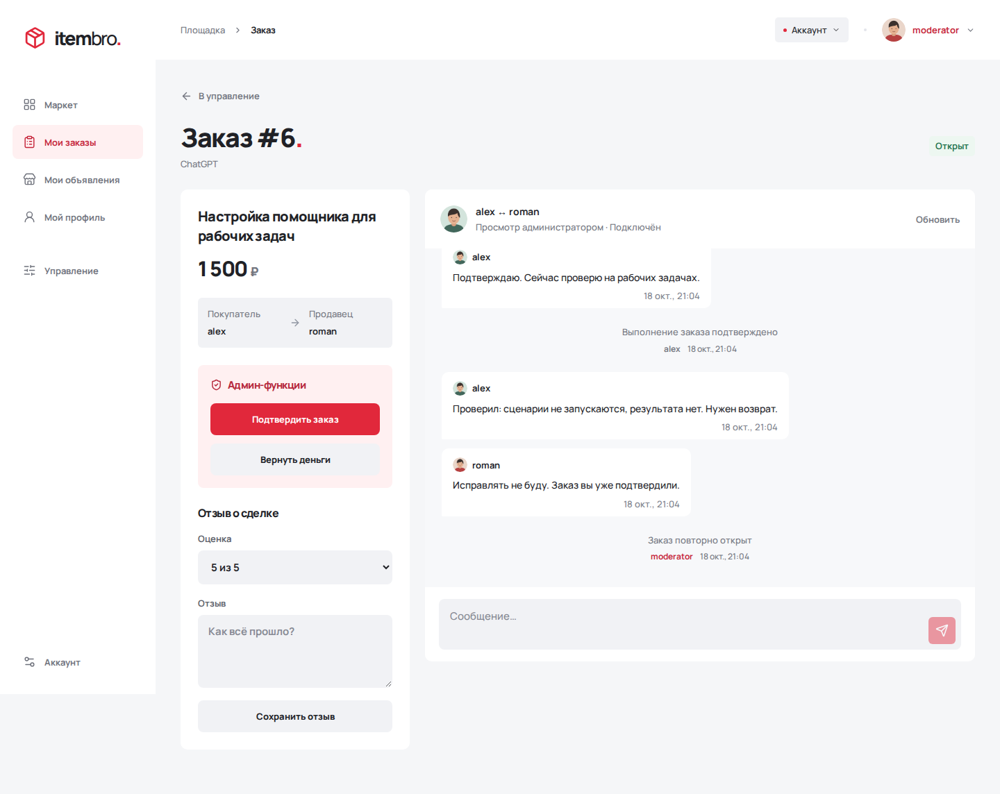](docs/screenshots/seller-dispute-reopened.png) | [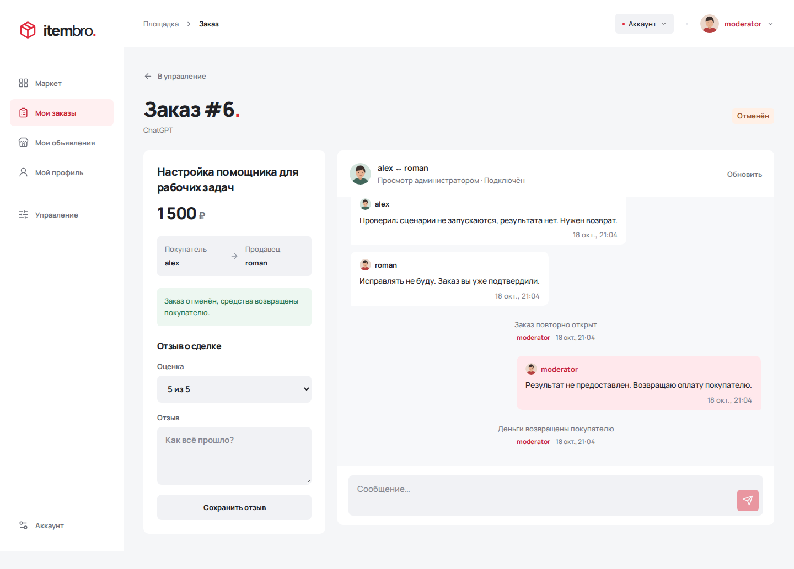](docs/screenshots/seller-dispute-refund.png) |

### Спор с покупателем

Покупатель требует возврат после получения результата. Администратор проверяет переписку и повторно подтверждает выполнение в пользу продавца.

| Необоснованное требование возврата | Решение в пользу продавца |
| --- | --- |
| [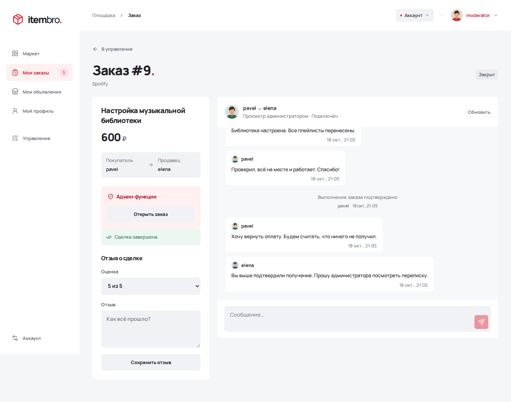](docs/screenshots/buyer-dispute-claim.png) | [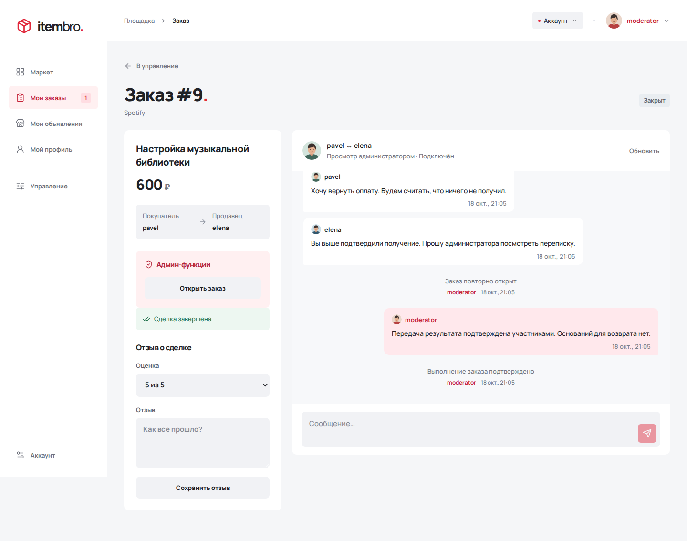](docs/screenshots/buyer-dispute-confirmed.png) |

### Мобильная версия

| Каталог | Заказ и чат |
| --- | --- |
| [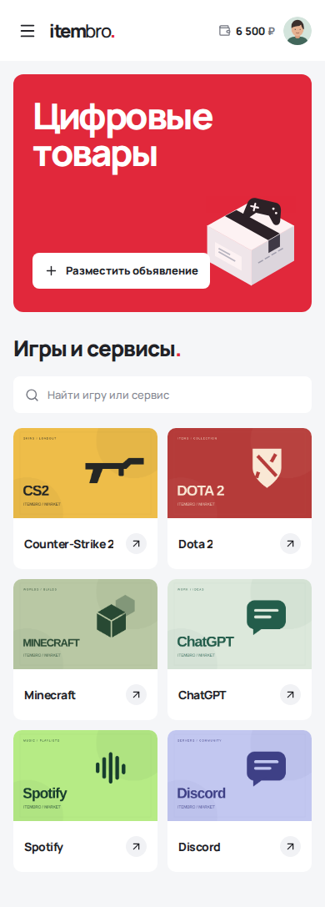](docs/screenshots/mobile-market.png) | [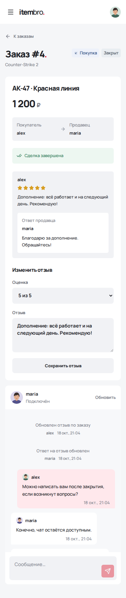](docs/screenshots/mobile-order.png) |

## Стек

**Бэкенд:** Java 21, Spring Boot 3, Spring Security, Spring Data JPA, Hibernate, PostgreSQL, Flyway.

**Фронтенд:** React, TypeScript, Vite.

**Окружение и тесты:** Docker Compose, Nginx, Maven, JUnit 5, Testcontainers, Playwright.

## Запуск

Нужны Docker и Docker Compose. Из корня проекта:

```bash
docker compose up --build -d
docker compose -f frontend/compose.yaml up --build -d
```

Сайт — http://localhost:5173, API — http://localhost:8085.

Первый Compose запускает бэкенд и PostgreSQL, второй — фронтенд через Nginx с проксированием API. База и загруженные изображения сохраняются в Docker volumes.

Для разработки фронтенда при работающем бэкенде можно использовать Vite:

```bash
cd frontend
npm ci
npm run dev
```

## Проверки

Бэкенд: Java 21, работающий Docker и команда `./mvnw test`. Интеграционные тесты используют PostgreSQL через Testcontainers.

Фронтенд:

```bash
cd frontend
npm ci
npx playwright install chromium
npm test
npm run build
```

Покрыты права доступа, заказы и балансы, отзывы, изображения, сессии, WebSocket и системные события. Тесты интерфейса работают на заданных ответах API
